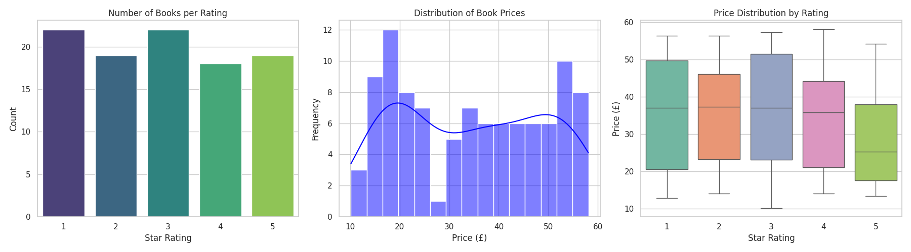
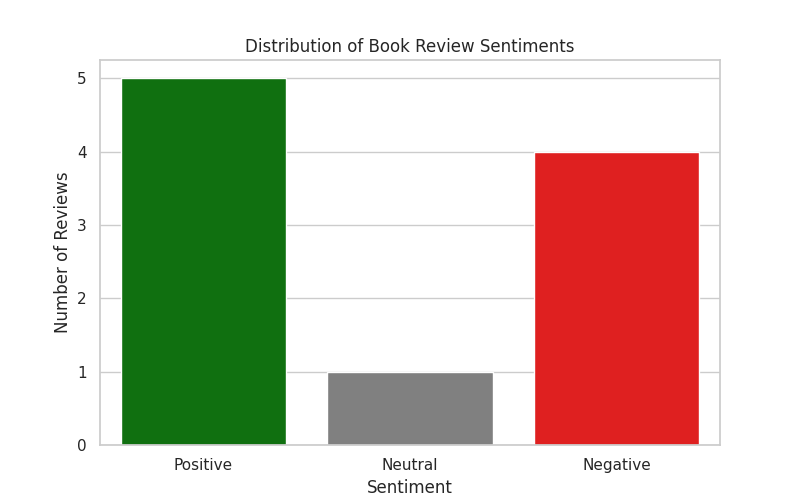

# CodeAlpha Data Analytics Internship

## Overview
This repository contains all 4 tasks completed during my Data Analytics Internship with CodeAlpha (Batch: Oct 20, 2026 - Nov 20, 2026).

## Tasks Completed

### Task 1: Web Scraping
*   **File:** `CodeAlpha_WebScraping.ipynb`
*   **Description:** Used Python (`Requests` & `BeautifulSoup`) to scrape 100 books (Title, Price, Rating, Availability) from `books.toscrape.com`. Cleaned the data using `Pandas` and exported it to `clean_books_data.csv`.

### Task 2 & 3: Exploratory Data Analysis (EDA) & Data Visualization
*   **File:** `CodeAlpha_EDA_and_Visualization.ipynb`
*   **Description:** Analyzed the scraped book dataset to find pricing trends and rating distributions. 
*   **Key Findings:** The average book price is £34.56. There is no positive correlation between price and rating (5-star books tend to be slightly cheaper). Used `Matplotlib` and `Seaborn` to create visualizations.
*   **Visualizations:**
    

### Task 4: Sentiment Analysis
*   **File:** `CodeAlpha_Sentiment_Analysis.ipynb`
*   **Description:** Used Natural Language Processing (NLP) with the `TextBlob` library to analyze book reviews. Classified text as Positive, Negative, or Neutral and visualized the sentiment distribution.
*   **Visualizations:**
    

## Author
**Kenneth Malgas**
